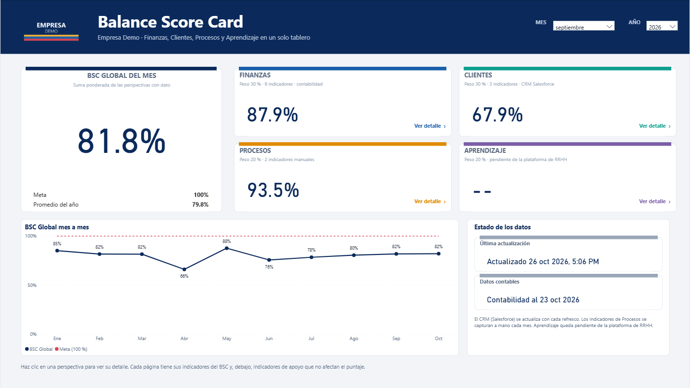
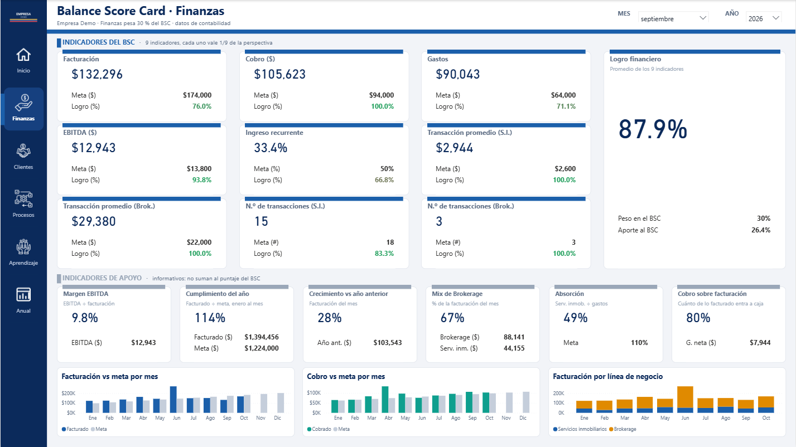
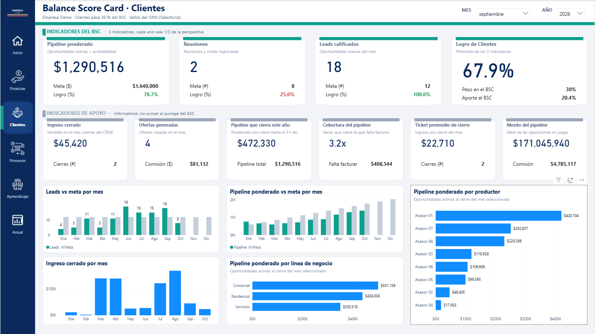
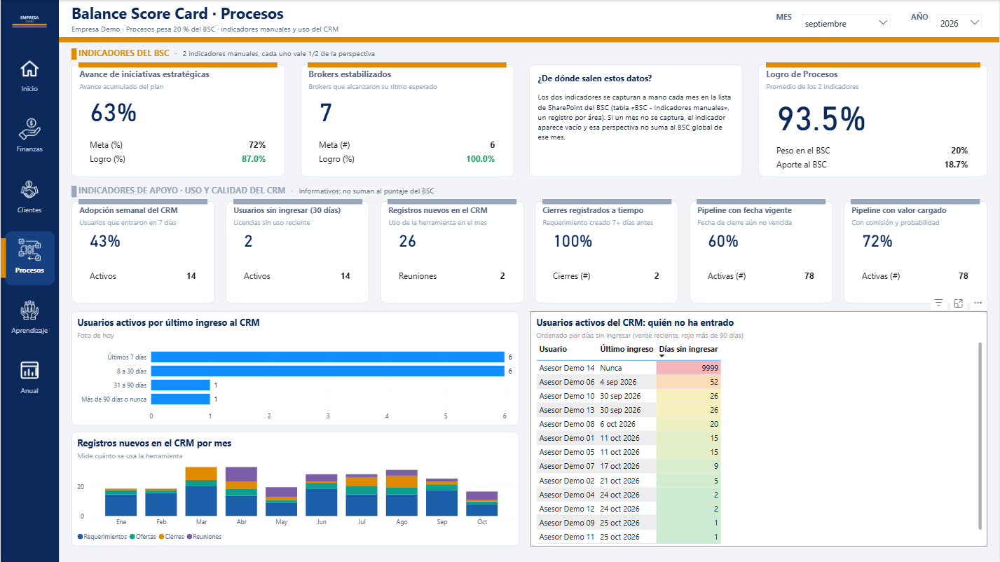
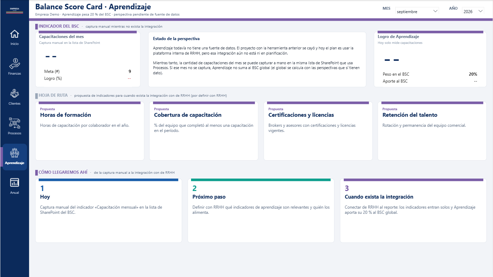
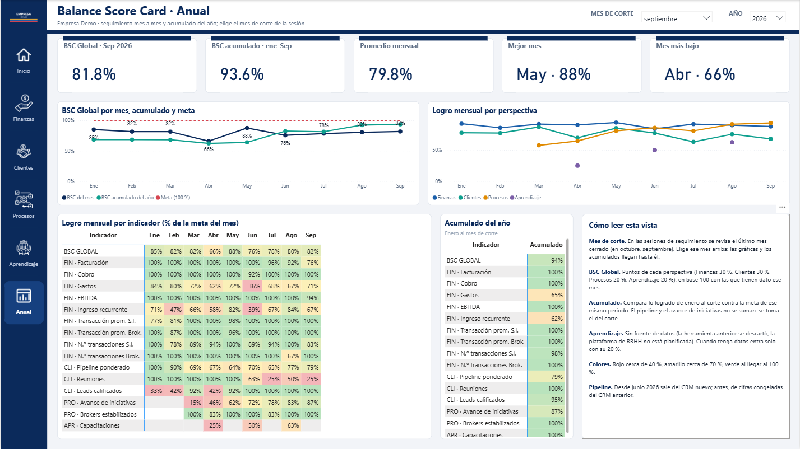

# Balanced Scorecard en Power BI: del CRM y la contabilidad a un solo número

Tablero de **Balance Score Card (BSC)** para la oficina de una empresa de servicios inmobiliarios. Junta la contabilidad,
el CRM comercial y capturas manuales en **un resultado mensual** y en una **vista anual** pensada para la sesión de seguimiento
de la gerencia. Se rediseñó por completo al cambiar de CRM, y suma indicadores de apoyo en cada área.

> Las imágenes usan **datos inventados** y una marca genérica. El proyecto real es interno; este repositorio no contiene código ni datos.

## El problema

- El tablero llevaba meses sin usarse: la empresa **cambió de CRM** y todo lo comercial quedó apuntando a un sistema apagado.
- El resultado dependía de cifras sueltas: nadie podía decir de un vistazo «cómo vamos» frente a las metas del mes.
- En las sesiones de seguimiento se revisa el **mes anterior** (en octubre se habla de septiembre), pero el tablero solo sabía del mes en curso.
- Las áreas de **Procesos** y **Aprendizaje** dependían de capturas manuales y de una herramienta que nunca llegó a implantarse.
- Nadie medía **si el CRM se estaba usando bien**, y sin eso las cifras comerciales no son fiables.

## Qué hace ahora

| Página | Para qué sirve |
|---|---|
| Portada | El **BSC Global del mes**, el logro de cada área, la evolución mes a mes contra la meta y el estado de los datos. |
| Finanzas | 9 indicadores contra meta (facturación, cobro, gastos, EBITDA, ingreso recurrente, transacciones) y una franja de apoyo: margen, cumplimiento del año, crecimiento, mix de línea de negocio. |
| Clientes | Pipeline ponderado, reuniones y oportunidades nuevas desde el CRM, más cobertura del pipeline, ticket promedio y ranking por asesor. |
| Procesos | Indicadores manuales y, como apoyo, **adopción y calidad de uso del CRM**: quién entró esta semana, quién no, y si las ventas se registran antes de cerrarse. |
| Aprendizaje | Estado de la perspectiva y una **hoja de ruta** con los indicadores que se medirán cuando exista la integración con RRHH. |
| Anual | Selector de **mes de corte**, BSC mensual y acumulado, logro por área y por indicador mes a mes, y los indicadores **acumulados del año** contra la meta del mismo período. |

## Cómo se usa

1. Se entra desde el portal corporativo de reportes y se elige el **mes** (en las sesiones, el último mes cerrado).
2. La portada responde «¿cómo vamos?»; con un clic en un área se ve su detalle.
3. Cada indicador muestra la cifra, la **meta** y el **logro** (verde desde 80 %, rojo bajo 50 %). La franja gris de **apoyo** ayuda a gestionar, pero no suma al puntaje.
4. En la vista **Anual** se elige el mes de corte y se ve el comportamiento del año y los indicadores acumulados.

## Decisiones que hicieron la diferencia

- **Congelar el CRM anterior** en una tabla fija y unirlo al CRM nuevo con una fecha de corte: el año completo se ve sin saltos y el refresco ya no depende de un sistema apagado.
- **Pipeline como «saldo abierto»**: las metas crecen mes a mes porque son de saldo. Con la definición anterior (lo que cerraba cada mes) el indicador quedaba en 4 % de logro sin que nada estuviera mal.
- **Indicadores de estado vs. de flujo**: cada indicador sabe cómo acumularse (sumar, promediar o tomar el último saldo), así el «acumulado del año» no es una suma ciega.
- **BSC global sobre las áreas que tienen dato**: si falta una captura manual, el área no entra y el resultado se rebasa a 100 en lugar de castigar por lo que no se capturó.
- **Mes de corte** como selector independiente: todas las medidas y gráficas de la vista anual se detienen en ese mes, y los meses posteriores quedan vacíos en lugar de en cero.
- **Indicadores de apoyo en cada área**, separados del puntaje, para dar contexto sin tocar las metas ni el cálculo oficial.
- **Medir la adopción del CRM**: qué parte del equipo lo usa y si se registra a tiempo, porque la calidad de la perspectiva comercial depende de ello.
- **Finanzas cuadradas al centavo** contra el reporte financiero oficial, con las diferencias encontradas documentadas y corregidas.
- **Diseño a 1920 × 1080**, el estándar de las laptops de la empresa, con color por perspectiva y barras de acento fuera de las tarjetas para que el título respire.
- **Proyecto generado por código** (modelo semántico y páginas), lo que permite iterar el diseño sin tocar cada visual a mano, y un **proyecto demo con datos inventados** para capturas y pruebas.

## Tecnologías

Power BI (PBIP: TMDL + PBIR) · Power Query (M) · DAX · SQL · Salesforce (CRM) · SharePoint · Node.js · PowerShell

## Contacto

LinkedIn: https://www.linkedin.com/in/jordandiax/ · GitHub: https://github.com/JordanDiaz07 · Teléfono: +507 63965192
